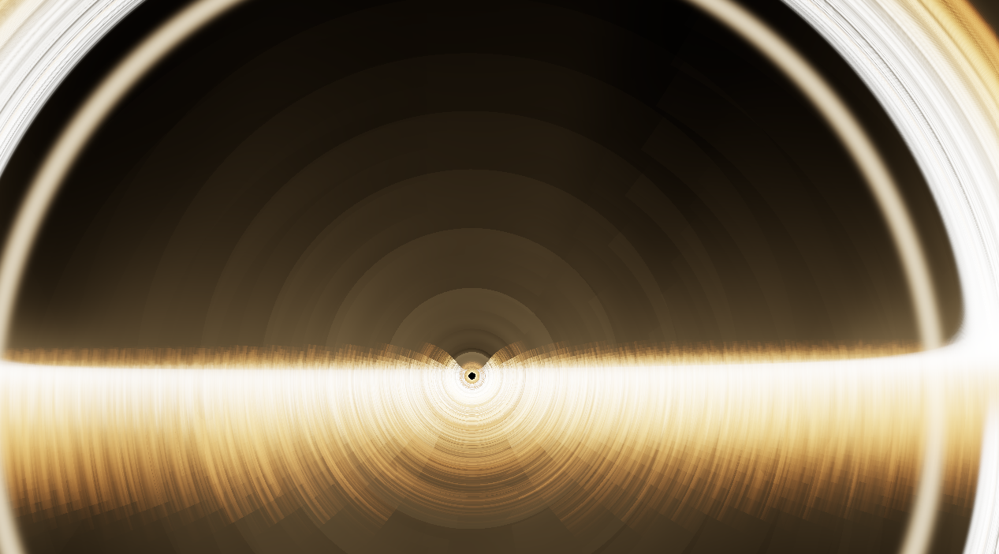
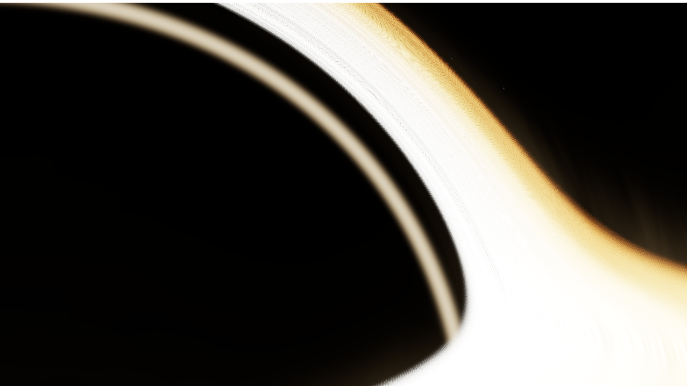
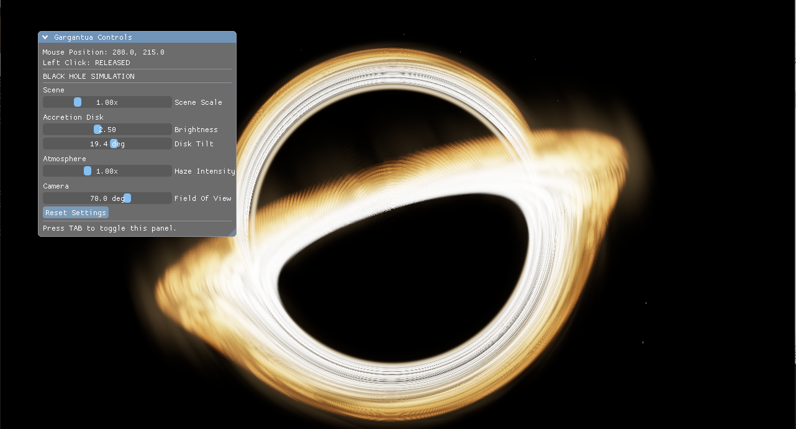

# Black Hole Simulation

 


# Black Hole Simulation — C++ & Vulkan

A real-time black hole simulation built from scratch using **C++, Vulkan, and GLSL**. The project explores GPU-based rendering, gravitational light bending, HDR rendering, and post-processing techniques while focusing on performance and low-level graphics programming.

## Overview

The simulation renders a black hole surrounded by an accretion disk, with gravitational lensing bending the light from the surrounding environment.

Rather than rendering a conventional 3D model, the scene is generated using a fullscreen triangle and a fragment shader. Each fragment traces a ray through the simulated gravitational field to determine what the camera would observe.

The project is also an exploration of modern Vulkan rendering architecture, including explicit resource management, synchronization, image layouts, descriptor sets, and multi-pass rendering.

## Technologies

- **C++** — Core application and rendering architecture
- **Vulkan** — Low-level graphics API
- **GLSL** — Vertex and fragment shaders
- **SDL3** — Window creation, input, and application management
- **Volk** — Vulkan function loading
- **VMA** — Vulkan Memory Allocator
- **shaderc** — GLSL shader compilation
- **Dear ImGui** — Runtime controls and parameter adjustment

## Rendering Architecture

The renderer uses Vulkan dynamic rendering and a multi-pass post-processing architecture.

### 1. Black Hole Scene Rendering

The scene is rendered into an offscreen HDR image instead of directly into the swapchain.

A fullscreen triangle covers the rendering area, allowing the fragment shader to perform the scene calculations for each pixel.

The shader includes:

- Schwarzschild-inspired gravitational ray tracing
- Numerical integration using the Runge–Kutta 4 (RK4) method
- Gravitational lensing
- Accretion disk rendering
- Procedural space background and volumetric-style haze
- Camera-dependent ray generation

### 2. HDR Rendering

The original scene is stored in a floating-point HDR image:

`VK_FORMAT_R16G16B16A16_SFLOAT`

This preserves brightness values beyond the conventional 0–1 display range, allowing bright accretion disk regions to contribute to bloom before tone mapping.

### 3. Bloom Extraction

A dedicated fragment shader extracts bright regions from the HDR scene.

The extraction pass uses a brightness threshold and soft-knee calculation to produce a smoother transition between bright and dark regions.

The resulting image contains the highlights that will contribute to the bloom effect.

### 4. Gaussian Blur

The extracted highlights are intended to pass through two separable Gaussian blur operations:

- Horizontal blur
- Vertical blur

Separate intermediate images are used to avoid sampling from and rendering to the same image during a pass.

### 5. Composite and Tone Mapping

The final composite shader combines the original HDR scene with the bloom contribution.

It applies exposure and ACES filmic tone mapping to convert the HDR result into a displayable color range.

The final image is rendered to the swapchain, with Dear ImGui drawn on top.

## Vulkan Concepts Explored

This project involves implementing and understanding several low-level Vulkan concepts:

- Vulkan instance, physical device, logical device, and graphics queue management
- Swapchain creation and recreation
- Command pools and command buffers
- Frames in flight
- Binary and timeline semaphores
- Synchronization2 and `vkCmdPipelineBarrier2`
- Image memory barriers and image layout transitions
- Vulkan dynamic rendering
- Descriptor set layouts, descriptor sets, and pipeline layouts
- Push constants
- Offscreen rendering
- HDR image resources
- Multi-pass post-processing

## Project Structure

The project is organized around the application, rendering resources, shaders, and supporting Vulkan infrastructure.

```text
BlackHole/
├── Shaders/
│   ├── fullscreen.vert
│   ├── blackhole.frag
│   ├── bloom_extract.frag
│   ├── blur.frag
│   └── composite.frag
│
├── Source/
│   ├── Application
│   ├── Vulkan initialization
│   ├── Rendering
│   └── Resource management
│
├── vendor/
│   ├── SDL3
│   ├── volk
│   └── VMA
│
└── BlackHole.sln
```

*The directory tree is illustrative; adjust it to match the actual repository structure.*

## Building

### Requirements

- Windows
- Visual Studio with C++ development tools
- Vulkan SDK
- Vulkan-compatible graphics device and driver
- SDL3
- Volk
- Vulkan Memory Allocator (VMA)
- shaderc

### Build Instructions

1. Clone the repository:

   ```bash
   git clone https://github.com/Bananayt294/BlackHole.git
   ```

2. Open the solution in Visual Studio.

3. Configure the project to locate the Vulkan SDK and the required dependencies.

4. Build the project using the appropriate configuration and platform.

5. Ensure the required runtime DLLs and compiled shaders are available alongside the executable or at their expected paths.

*Exact dependency paths and build configurations depend on your local setup.*

## Current Development

The project is being developed incrementally, with an emphasis on understanding and implementing the underlying rendering techniques.

Current areas of development include:

- Black hole ray tracing and gravitational lensing
- HDR offscreen scene rendering
- Bright-pass bloom extraction
- Composite rendering and ACES tone mapping
- Separable Gaussian blur integration
- Rendering performance and resource synchronization

## Motivation

The goal of this project is not simply to produce a visually interesting simulation, but to understand how a modern graphics renderer works internally.

From numerical ray integration and fragment shader programming to Vulkan synchronization and multi-pass rendering, every major component is implemented with an emphasis on understanding the underlying graphics concepts.

The project serves as a practical exploration of real-time graphics programming, GPU architecture, and physically inspired rendering.

---

**Author:** [Bananayt294](https://github.com/Bananayt294)

MIT license
